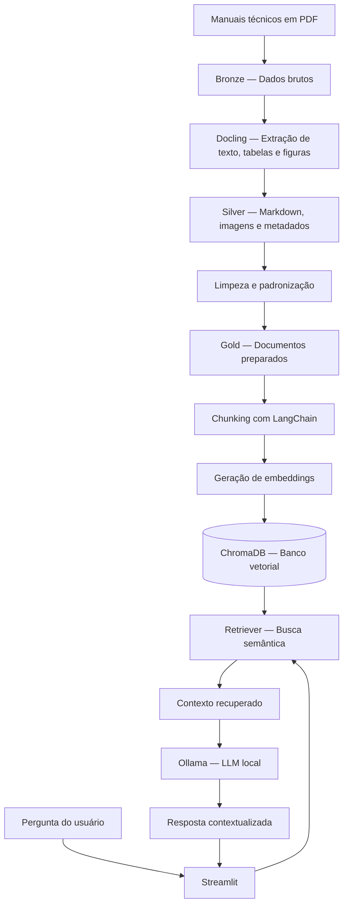

# 🏍️ Assistente de Manuais Técnicos de Motocicletas

Assistente baseado em Inteligência Artificial Generativa (LLM) e **Retrieval-Augmented Generation (RAG)**, desenvolvido para facilitar a consulta de informações técnicas presentes em manuais de motocicletas.

O projeto utiliza Python, LangChain, Ollama e ChromaDB para transformar documentos técnicos em uma base consultável por linguagem natural, incluindo referências a imagens, tabelas e diagramas extraídos dos manuais.

## 🎯 Problema de Negócio

Muitos proprietários de motocicletas não consultam o manual do proprietário com frequência e, quando precisam de uma informação específica, enfrentam dificuldades para localizar o conteúdo correto.

Dúvidas como a pressão adequada dos pneus, os intervalos de manutenção, a lubrificação da corrente e os procedimentos de conservação exigem a consulta de informações distribuídas ao longo de documentos técnicos.

A leitura manual desses documentos pode ser demorada, especialmente quando o usuário não sabe em qual seção procurar.

## 🚀 Solução Desenvolvida

Foi desenvolvido um assistente de manuais técnicos que permite realizar perguntas em linguagem natural e obter respostas fundamentadas no conteúdo dos documentos disponíveis.

O projeto é especializado em motocicletas custom de baixa e média cilindrada, abrangendo modelos entre 100 cc e 650 cc.

A solução utiliza uma arquitetura RAG para recuperar trechos relevantes dos manuais antes de gerar uma resposta com um modelo de linguagem local.

### Principais funcionalidades

- Conversão de manuais em PDF para Markdown.
- Extração de figuras, tabelas e imagens técnicas.
- Geração de metadados e referências para as imagens extraídas.
- Limpeza e padronização dos documentos processados.
- Divisão dos textos em chunks, preservando a estrutura dos documentos.
- Geração de embeddings e armazenamento vetorial no ChromaDB.
- Recuperação semântica de informações relevantes para cada pergunta.
- Geração de respostas com LLM executado localmente pelo Ollama.
- Interface de chat desenvolvida com Streamlit.
- Exibição de imagens técnicas relacionadas às respostas.
- Instruções para evitar respostas sem suporte no contexto recuperado.

O objetivo é tornar as informações técnicas mais acessíveis sem substituir o manual oficial ou os procedimentos de segurança recomendados pelo fabricante.

## 🏗️ Arquitetura do Pipeline

O pipeline foi organizado com base no conceito de **Medallion Architecture**, separando os dados em três camadas: Bronze, Silver e Gold.

Essa organização facilita a manutenção, a rastreabilidade e a evolução do processamento dos documentos.

### Visão geral



### 🥉 Bronze — Dados brutos

**Objetivo:** armazenar os documentos de entrada sem aplicar transformações no conteúdo.

Os manuais em PDF são utilizados como fonte para as etapas seguintes do pipeline.

Essa camada preserva os arquivos originais, permitindo que o processamento seja refeito quando necessário.

### 🥈 Silver — Extração e estruturação

**Objetivo:** converter os documentos originais em formatos mais adequados ao processamento automatizado.

O Docling é utilizado para converter os PDFs em Markdown e extrair elementos visuais identificados nos documentos.

Nesta etapa, o pipeline contempla:

- Extração do conteúdo textual.
- Identificação e exportação de figuras e tabelas.
- Geração de imagens em formato PNG.
- Criação de arquivos de metadados em JSON.
- Associação de referências às imagens no Markdown.
- Verificação de arquivos previamente processados, evitando conversões desnecessárias quando os arquivos de saída estão atualizados.

O resultado é um conjunto estruturado de documentos, imagens e metadados que preserva parte importante do contexto técnico original.

### 🥇 Gold — Preparação dos dados para consumo

**Objetivo:** disponibilizar documentos limpos e organizados para a aplicação de RAG.

O script de limpeza realiza operações como:

- Normalização de marcadores de listas.
- Tratamento de caracteres e sequências de hífens em tabelas.
- Redução de espaços duplicados.
- Padronização de sequências excessivas de pontos.
- Remoção de linhas vazias em excesso.
- Cópia de arquivos de imagem sem modificar seu conteúdo.

A estrutura de diretórios é preservada durante a cópia dos arquivos.

Essa camada funciona como a fonte de dados para a geração da base vetorial e para a aplicação Streamlit.

### 🔎 Chunking e geração de embeddings

Os documentos Markdown são carregados e divididos em unidades menores para permitir a recuperação de trechos relevantes.

O processo utiliza duas estratégias complementares:

1. **Divisão por cabeçalhos:** o `MarkdownHeaderTextSplitter` identifica a estrutura hierárquica do documento, preservando os títulos e seções.
2. **Divisão por tamanho:** o `RecursiveCharacterTextSplitter` subdivide trechos extensos em chunks menores, utilizando tamanho de 800 caracteres e sobreposição de 150 caracteres.

A sobreposição ajuda a reduzir a perda de contexto nas fronteiras entre chunks.

Em seguida, o modelo `nomic-embed-text`, executado pelo Ollama, converte os textos em embeddings, que representam seu conteúdo em um espaço vetorial.

Os vetores são armazenados no ChromaDB, permitindo recuperar os trechos semanticamente semelhantes à pergunta do usuário.

### 🧠 Recuperação e geração de respostas — RAG

Quando o usuário envia uma pergunta, a aplicação executa o seguinte fluxo:

1. A pergunta é recebida pela interface Streamlit.
2. O retriever consulta o ChromaDB e recupera trechos relevantes.
3. Os trechos recuperados são organizados em um contexto para o modelo.
4. O contexto e a pergunta são enviados ao LLM executado localmente pelo Ollama.
5. O modelo gera uma resposta orientada pelas informações recuperadas.
6. A interface apresenta a resposta e, quando as referências são reconhecidas, exibe as imagens correspondentes.

O prompt instrui o modelo a utilizar somente as informações presentes no contexto, não inventar dados e informar quando não encontrar a resposta nos manuais disponíveis.

O sistema também procura preservar a distinção entre modelos de motocicletas e identificar divergências entre informações recuperadas.

**Importante:** essas instruções reduzem o risco de respostas sem fundamento, mas não garantem ausência total de alucinações. Informações críticas de manutenção e segurança devem ser conferidas no manual oficial correspondente ao modelo e ao ano da motocicleta.

## 🧰 Tecnologias Utilizadas

| Tecnologia | Aplicação no projeto |
|---|---|
| Python | Desenvolvimento e orquestração do pipeline |
| Docling | Conversão de PDFs e extração de conteúdo técnico |
| LangChain | Integração dos componentes de RAG |
| Ollama | Execução local dos modelos de linguagem e embeddings |
| ChromaDB | Armazenamento e recuperação vetorial |
| Streamlit | Interface de interação com o usuário |
| Markdown | Representação estruturada do conteúdo extraído |
| JSON | Armazenamento de metadados dos documentos e imagens |
| python-dotenv | Gerenciamento de configurações por variáveis de ambiente |
| tqdm | Acompanhamento do progresso do processamento |

### Modelos utilizados

- **LLM:** `llama3`, configurável por variável de ambiente.
- **Embeddings:** `nomic-embed-text`, configurável por variável de ambiente.

Os modelos precisam estar instalados no Ollama e disponíveis localmente para que a aplicação funcione.

## 📚 Glossário

| Termo | Definição |
|---|---|
| RAG | Arquitetura que combina recuperação de informações externas com geração de respostas por um LLM. |
| LLM | Modelo de linguagem utilizado para interpretar perguntas e gerar respostas. |
| Chunking | Divisão de documentos extensos em unidades menores para processamento e recuperação. |
| Embedding | Representação numérica de um conteúdo que permite comparar sua similaridade semântica. |
| Banco vetorial | Banco de dados preparado para armazenar e consultar vetores por similaridade. |
| Retriever | Componente responsável por recuperar os trechos mais relevantes para uma consulta. |
| Medallion Architecture | Organização dos dados em camadas, geralmente Bronze, Silver e Gold. |
| Metadata | Informações complementares sobre um documento, como nome, origem, página ou referências a imagens. |
| LLM local | Modelo executado no ambiente local, sem exigir que cada pergunta seja enviada a uma API externa de inferência. |

## 📁 Organização do Projeto

A estrutura lógica esperada para os dados e scripts é:

```text
Case Assistente de Manual/
│
├── converter_com_indice.py
│   └── Conversão de PDFs, extração de imagens e metadados
│
├── limpeza_md.py
│   └── Limpeza e padronização dos documentos
│
├── gerador_banco_vetorial.py
│   └── Chunking, embeddings e persistência no ChromaDB
│
├── dash.py
│   └── Interface de chat em Streamlit
│
├── .env
│   └── Caminhos e configurações locais
│
├── camada_bronze/
│   └── PDFs originais
│
├── camada_silver/
│   ├── arquivos Markdown
│   ├── arquivos JSON de metadados
│   └── images/
│
├── camada_gold/
│   ├── documentos processados
│   ├── referências a imagens
│   └── imagens técnicas
│
└── chroma_db/
    └── Persistência local do banco vetorial
```

*Nota: essa é uma representação lógica da organização proposta. Os diretórios efetivos são definidos pelas variáveis de ambiente, e os nomes dos arquivos Python podem variar conforme a versão utilizada.*

## ⚙️ Configuração e execução

### 1. Pré-requisitos

- Python instalado.
- Ollama instalado e em execução.
- Os modelos `llama3` e `nomic-embed-text` disponíveis no Ollama.
- Dependências Python instaladas.
- Manuais técnicos em PDF para processamento.

Para instalar os modelos:

```bash
ollama pull llama3
ollama pull nomic-embed-text
```

### 2. Instalação das dependências

Instale as bibliotecas utilizadas pelo projeto:

```bash
pip install python-dotenv docling langchain langchain-core langchain-text-splitters langchain-chroma langchain-ollama chromadb streamlit tqdm
```

### 3. Configuração das variáveis de ambiente

Crie um arquivo `.env` na raiz do projeto, utilizando os caminhos locais correspondentes:

```dotenv
camada_bronze=CAMINHO_DA_CAMADA_BRONZE
camada_silver=CAMINHO_DA_CAMADA_SILVER
camada_gold=CAMINHO_DA_CAMADA_GOLD

VECTOR_DB_PATH=CAMINHO_DO_BANCO_VETORIAL
VECTOR_COLLECTION_NAME=manuais_docs

OLLAMA_EMBEDDING_MODEL=nomic-embed-text
OLLAMA_LLM_MODEL=llama3
```

Substitua os valores de exemplo pelos caminhos existentes no seu ambiente. Não publique caminhos privados ou credenciais desnecessárias no repositório.

### 4. Executar o pipeline de dados

Execute os scripts na seguinte ordem:

1. **Conversão:** processa os PDFs e gera Markdown, imagens e metadados.
2. **Limpeza:** normaliza o conteúdo extraído e prepara os arquivos para consumo.
3. **Geração da base vetorial:** divide os documentos em chunks, gera embeddings e armazena os vetores no ChromaDB.
4. **Aplicação:** inicia a interface para consultas aos manuais.

Exemplo de execução:

```bash
python converter_com_indice.py
python limpeza_md.py
python gerador_banco_vetorial.py
streamlit run dash.py
```

Os nomes acima representam os papéis dos scripts. Ajuste-os para os nomes reais dos arquivos no repositório.

## 🔐 Privacidade e limitações

- Os modelos são executados localmente por meio do Ollama.
- A persistência vetorial é realizada localmente pelo ChromaDB, conforme configurado.
- O projeto não depende de uma API externa de LLM no fluxo apresentado.
- O processamento local não elimina a necessidade de proteger os documentos, os arquivos de configuração e o ambiente de execução.
- A qualidade das respostas depende da qualidade da extração, da segmentação dos documentos e da recuperação dos trechos corretos.
- A extração de imagens e tabelas pode apresentar limitações dependendo da estrutura do PDF.
- A aplicação deve ser validada com perguntas reais antes de ser utilizada para orientar procedimentos de manutenção.

## 🚧 Próximos passos

- Melhorar a associação entre imagens, páginas e trechos recuperados.
- Garantir a integração consistente entre os metadados JSON e a base vetorial.
- Avaliar estratégias de recuperação híbrida, combinando busca textual e semântica.
- Implementar avaliação sistemática da qualidade das respostas e da recuperação.
- Melhorar a identificação das fontes, páginas e versões dos manuais.
- Avaliar alternativas de implantação e armazenamento em nuvem para facilitar escalabilidade e disponibilização da aplicação.

## 🎯 Objetivo do projeto

Este projeto foi desenvolvido como estudo prático de Engenharia de Dados e aplicações de IA Generativa, explorando o ciclo de vida dos dados — desde a ingestão e transformação de documentos até sua disponibilização para recuperação semântica e geração de respostas.

Mais do que criar um chatbot, a proposta é demonstrar como estruturar dados não convencionais, preservar contexto técnico e construir um pipeline que transforme documentos em uma fonte de informação consultável.

---

**Tecnologias:** Python · Docling · LangChain · Ollama · ChromaDB · Streamlit · RAG · Medallion Architecture
